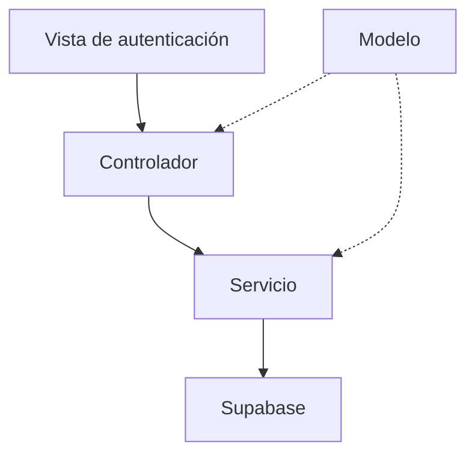

# Organización del código de PsicoBloom

Base revisada: commit `4b3b059`, rama `refactor/estructura-mvc`.

## Propósito y alcance

Organizar el cliente Flutter mediante MVC por módulos, con servicios y repositorios como apoyo para el acceso a datos. La separación aplicada comprende los flujos de autenticación existentes, la coordinación de enlaces, la búsqueda del paciente y el gestor de favoritos. No incorpora funciones nuevas del MVP ni implica que los paneles de todos los roles estén implementados.

La arquitectura general sigue siendo cliente Flutter y servicios en la nube. MVC describe la organización interna del cliente. El sitio `web_autenticacion` actúa como página auxiliar para enlaces de autenticación; no constituye una versión web completa de la aplicación.

## Responsabilidades

| Elemento | Responsabilidad | Ejemplo actual |
| --- | --- | --- |
| Vista | Mostrar información, capturar campos, validar el formulario y presentar diálogos o navegación. | `PantallaIniciarSesion` |
| Controlador | Coordinar operaciones, estados de carga y errores; evitar solicitudes simultáneas y notificaciones después del cierre. | `ControladorInicioSesion` |
| Modelo | Representar datos y criterios. | `PerfilUsuario`, `Profesional`, `FiltroProfesional`, `EnlaceAutenticacion` |
| Servicio | Comunicarse con Auth o el servidor y comprobar su respuesta. | `ServicioInicioSesion` |
| Repositorio | Definir consultas de una fuente de profesionales e implementar su acceso. | `RepositorioProfesionales`, `RepositorioProfesionalesSimulado` |
| Componente | Reutilizar una parte de la interfaz. | `TarjetaProfesional` |

Los controladores usan `ChangeNotifier` para comunicar sus cambios a las vistas. Las vistas registran y retiran sus escuchas y disponen de sus controladores al cerrarse. Las llamadas a `Navigator`, los diálogos y `BuildContext` permanecen en la interfaz. Los servicios conservan las comprobaciones que dependen del servidor.

Un `TextEditingController` administra un campo de texto; no sustituye a un controlador MVC. No es necesario crear un controlador MVC para cada pantalla estática ni trasladar al controlador el estado puramente visual, como mostrar u ocultar una contraseña.

## Mapa de carpetas

| Ruta | Contenido |
| --- | --- |
| `lib/main.dart` | Inicialización de Flutter, configuración de Supabase, aplicación principal y navegación según los enlaces coordinados. |
| `lib/main_desarrollo.dart` | Entrada de previsualización del paciente con datos simulados. |
| `lib/configuracion/` | Configuración compartida, incluida la lectura de valores de Supabase por `--dart-define`. |
| `lib/modelos/` | Modelos compartidos: perfil, profesional y filtro. |
| `lib/datos/` | Datos simulados del directorio. |
| `lib/repositorios/` | Contrato de consultas e implementación simulada de profesionales. |
| `lib/nucleo/componentes/` | Fondo decorativo e icono de Google compartidos. |
| `lib/nucleo/tema/` | Paleta y tema visual de PsicoBloom. |
| `lib/modulos/autenticacion/` | Vistas, controladores, servicios y modelo de enlaces de autenticación. |
| `lib/modulos/paciente/` | Vistas, componentes y controladores del paciente. |
| `test/` | Pruebas automatizadas de modelos, coordinación y widgets. |
| `web_autenticacion/` | Sitio auxiliar y configuración de Firebase Hosting. Se conserva separado de Flutter. |
| `android/`, `ios/`, `web/`, `windows/`, `linux/`, `macos/` | Proyectos de plataforma de Flutter; no se reorganizaron como parte de MVC. |

Las antiguas carpetas vacías `lib/pantallas` y `lib/servicios` se retiraron después de mover sus archivos. Los modelos y repositorios compartidos permanecen fuera de los módulos; esa ubicación no contradice la separación de responsabilidades.

## Módulo de autenticación

Raíz: `lib/modulos/autenticacion/`.

| Controlador en `controladores/` | Vista o integración | Operación coordinada |
| --- | --- | --- |
| `controlador_inicio_sesion.dart` | `vistas/pantalla_iniciar_sesion.dart` | Solicitar acceso, gestionar carga y errores, devolver el perfil a la vista. |
| `controlador_registro.dart` | `vistas/pantalla_registro_paso_dos.dart` | Coordinar registro y aceptación de términos; impedir envíos simultáneos o repetidos tras una respuesta aceptada. |
| `controlador_recuperar_clave.dart` | `vistas/pantalla_recuperar_clave.dart` | Solicitar el correo de recuperación y comunicar el resultado. |
| `controlador_nueva_clave.dart` | `vistas/pantalla_nueva_clave.dart` | Validar explícitamente el enlace antes de permitir guardar la contraseña nueva. |
| `controlador_verificar_correo.dart` | `vistas/pantalla_verificar_correo.dart` | Confirmar el enlace, consultar la sesión y el perfil, gestionar reenvíos y su espera de 60 segundos. |
| `controlador_enlaces_autenticacion.dart` | `lib/main.dart` | Escuchar enlaces, esperar al arranque, controlar duplicados y conservar el último pendiente mientras hay un proceso activo. |

| Servicio en `servicios/` | Responsabilidad conservada |
| --- | --- |
| `servicio_inicio_sesion.dart` | Autenticar y comprobar perfil y acceso al panel del paciente. |
| `servicio_registro.dart` | Registrar, solicitar reenvío y consultar confirmación y perfil propio. |
| `servicio_recuperacion_clave.dart` | Solicitar el enlace de recuperación. |
| `servicio_enlace_autenticacion.dart` | Confirmar o recuperar mediante un cliente temporal separado de la sesión global; verificar la identidad antes de guardar la clave. |

El modelo de enlaces se encuentra en `modelos/enlace_autenticacion.dart`. Las demás vistas del módulo son carga, opciones de acceso, primer paso de registro y completar perfil. Permanecen como interfaz o previsualización según su implementación actual; agruparlas no convierte una simulación en una integración real.

La flecha representa la solicitud de la operación. El servicio devuelve su resultado al controlador; la vista escucha los cambios y presenta el resultado. En el inicio de sesión, la vista navega al panel del paciente únicamente después de recibir el perfil aceptado por el servicio.

### Condiciones que deben conservarse

- Una solicitud de registro o reenvío aceptada no demuestra que el mensaje se haya entregado ni que una dirección corresponda a una cuenta nueva.
- La ausencia de sesión confirmada local no demuestra que el correo siga sin confirmar en otro navegador o dispositivo.
- La confirmación del enlace es manual, mediante el botón de su pantalla.
- El cliente temporal de recuperación no sustituye a la sesión ordinaria para entrar al panel.
- Los roles y el acceso al panel se comprueban mediante las respuestas del servidor; la selección del formulario no concede permisos.
- Las contraseñas no se guardan como campos del controlador ni se imprimen en consola.
- Al cerrar una pantalla se cancelan sus temporizadores o suscripciones y se evitan notificaciones tardías. Esto no equivale a cancelar toda solicitud de red ya iniciada.

## Módulo del paciente

Raíz: `lib/modulos/paciente/`.

| Ruta | Función |
| --- | --- |
| `vistas/pantalla_inicio_paciente.dart` | Inicio y accesos del paciente; conserva el listado de demostración. |
| `vistas/pantalla_buscar_profesionales.dart` | Campos, filtros, resultados y navegación de búsqueda. |
| `controladores/controlador_buscar_profesionales.dart` | Cargar catálogos, coordinar consultas y descartar respuestas antiguas cuando ya existe una búsqueda posterior. |
| `controladores/gestor_favoritos.dart` | Compartir favoritos en memoria entre las vistas. |
| `componentes/barra_navegacion_paciente.dart` | Navegación inferior reutilizable. |
| `componentes/tarjeta_profesional.dart` | Presentación reutilizable de un profesional. |

El controlador de búsqueda recibe `RepositorioProfesionales`. La implementación actual es simulada y obtiene sus datos de `lib/datos/profesionales_simulados.dart`. Los favoritos permanecen en memoria, sin persistencia en Supabase. No se agregó un controlador artificial para duplicar las acciones visuales del inicio.

## Reglas para continuar el desarrollo

1. Ubicar la interfaz específica en `modulos/<modulo>/vistas` y sus componentes propios en `componentes`.
2. Colocar en un controlador la coordinación que deba probarse separada de la pantalla.
3. Mantener las llamadas externas en servicios o repositorios, según el contrato existente. No crear ambas capas para una operación si solo duplican llamadas sin aportar una responsabilidad.
4. Conservar los elementos realmente compartidos en las carpetas comunes.
5. Actualizar importaciones y pruebas en el mismo cambio que mueve o renombra un archivo.
6. Retirar escuchas y disponer de los recursos que posee cada objeto. Cancelar temporizadores de pruebas antes de que finalice su caso de widgets.
7. Conservar identificadores en español sin tildes ni ñ y archivos en `snake_case`, conforme a `AGENTS.md`.
8. Ejecutar las verificaciones y revisar el cambio antes del commit. No editar archivos generados ni introducir claves privadas en el cliente.

## Evidencia de verificación

Resultados ejecutados por la desarrolladora antes del commit base de este documento:

| Comprobación | Resultado informado |
| --- | --- |
| `flutter analyze` | `No issues found!` |
| `flutter test` | 83 pruebas aprobadas. |
| Búsqueda, filtros y sincronización de favoritos | Comprobación visual realizada durante la reorganización. |
| Inicio de sesión y cambio de contraseña | Funcionaron tras agrupar las carpetas; después se extrajeron los controladores. Repetir el recorrido final sobre esa versión. |

Las pruebas de coordinación utilizan servicios o fuentes simuladas. No sustituyen una comprobación con el proveedor real ni prueban por sí solas políticas o permisos del servidor. No se ejecutó Flutter ni un emulador en el entorno que preparó este documento; la evidencia anterior corresponde a las ejecuciones compartidas por la desarrolladora.

## Pendientes del cierre funcional

| Caso en la versión final | Evidencia necesaria |
| --- | --- |
| Inicio de sesión | Ingresar con una cuenta existente y llegar al panel esperado. |
| Recuperación | Solicitar un enlace nuevo, validarlo, guardar una clave y entrar con ella. |
| Confirmación de cuenta nueva | Abrir un mensaje vigente, confirmar e iniciar sesión con la cuenta. Sigue pendiente por falta de otra dirección disponible. |
| App Links | Comprobar el recorrido real con la app abierta y con la app cerrada. |

No se requieren nuevas funciones para completar estas comprobaciones. Google y completar perfil conservan su condición de previsualización; este trabajo no implementa OAuth. Los datos de profesionales siguen siendo referenciales. Tampoco se incorporan los paneles pendientes de profesional o administrador.

La reorganización estructural está implementada y sus verificaciones automatizadas están aprobadas. El cierre funcional queda pendiente hasta registrar los recorridos reales indicados.
